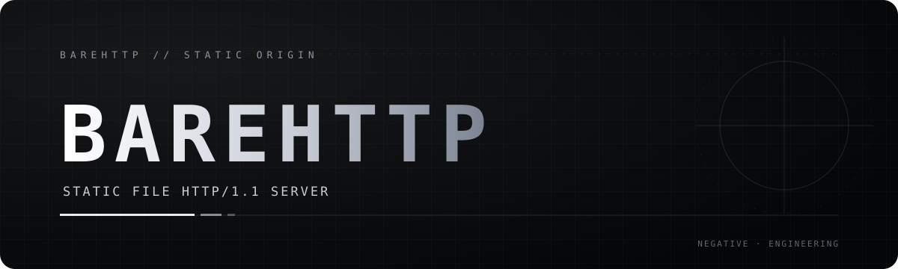

<div align="center">



# barehttp

**Zero-dependency static file HTTP/1.1 server in Rust — no crates, no async runtime.**

<p>
  
  
  
  
  
</p>

</div>

> barehttp (formerly `barehttp`) serves one directory over HTTP/1.1 with bounded
> request framing, traversal-safe path resolution and conditional requests.

## What it is

barehttp is a static file server written against the Rust standard library only:
`std::net`, `std::fs`, `std::io`. Each connection gets a thread, the request head
is read incrementally up to 16 KiB, and one response is written before the
connection closes. It exists to be small enough to audit and strict enough to
put in front of real files.

The crate and the installed command keep their original names, `sifr-serve`;
the product name is barehttp and the repository is still `Sifr-Dev/barehttp`.

## Current capabilities

- **GET and HEAD** with byte-accurate `Content-Length`; HEAD suppresses the body
  but keeps its length (`render`/`send`, `src/main.rs`; test
  `head_suppresses_the_body_but_keeps_its_length`).
- **Correct statuses** — 200, 304, 400, 403, 404, 405, 413, 431 (`handle`,
  `framing_status`, `src/main.rs`).
- **Bounded incremental head parsing** — reads stop at `CRLFCRLF`, capped at
  16 KiB, so fragmented TCP segments are assembled and an unterminated head is
  answered 431 (`MAX_HEAD_BYTES`, `read_request_head`; tests
  `headers_and_delimiters_fragmented_across_many_writes_are_served`,
  `over_limit_socket_head_returns_431`).
- **Strict body framing** — conflicting or duplicated `Content-Length` and any
  `Transfer-Encoding` are rejected with 400; a declared body over 64 KiB is
  answered 413 (`parse_request_checked`, `framing_status`; tests
  `malformed_content_length_is_rejected`,
  `transfer_encoding_conflicts_and_duplicates_are_rejected`,
  `declared_body_over_the_existing_limit_returns_413`).
- **Traversal-safe paths** — query strings stripped, percent escapes decoded,
  then the candidate is canonicalized and must stay under the root; escapes are
  refused with 403 when the outside target exists and 404 when it does not, and
  are never served (`resolve_target`; tests `traversal_out_of_the_root_is_rejected`,
  `sibling_directory_with_shared_prefix_is_rejected`).
- **Directory index** — a directory request resolves to `index.html`, or 404 if
  absent (`resolve_target`; tests `directory_request_resolves_to_index_html`,
  `directory_without_index_is_not_found`).
- **MIME by extension** — html/css/js/json/md/png/pdf/wasm/wav/flac and more
  (`mime_type`, `src/main.rs`; test `maps_extensions_to_content_types`).
- **Conditional requests** — `Last-Modified` plus exact `If-Modified-Since`
  returns 304 (`handle`; test
  `end_to_end_conditional_request_matches_its_own_last_modified`).
- **Stalled-client bound** — a 10 s read timeout on the head, so a silent peer
  cannot pin a worker thread (`HEAD_READ_TIMEOUT`).
- **37 deterministic tests**, including real loopback exchanges on ephemeral
  ports (`cargo test`, `src/main.rs` `#[cfg(test)]`).

## Quick start

```sh
git clone https://github.com/Sifr-Dev/barehttp.git
cd barehttp
cargo build --release
./target/release/sifr-serve /var/www --port 8090
```

Default root is the current directory and the default port is 8080. Verified
against a temporary webroot on this machine:

```sh
mkdir -p /tmp/webroot && echo '<h1>index</h1>' > /tmp/webroot/index.html
./target/release/sifr-serve /tmp/webroot --port 8899 &
curl -si localhost:8899/
```

There is no `--help` flag; the first positional argument is the root and
`--port N` is the only option.

## Verification

```sh
cargo build --locked
cargo test --locked            # 37 passed
cargo test --release --locked  # 37 passed
```

Observed on this machine (2026-11-28; Rust 1.100.0, AMD Ryzen 7 7435HS,
Linux 7.3.4):

```text
test result: ok. 37 passed; 0 failed; 0 ignored; 0 measured; 0 filtered out
```

Live check against the release binary:

```text
GET /style.css             -> 200 text/css; charset=utf-8, 50 bytes
GET /                      -> 200 (index.html)
GET /nope.txt              -> 404
GET /../../etc/passwd      -> 404 (target does not exist inside the tree);
                              traversal never resolves outside the root
POST /                     -> 405
If-Modified-Since: <LM>    -> 304
```

CI (`.github/workflows/ci.yml`) runs `cargo build --locked`, `cargo test
--locked` and `cargo test --release --locked`.

## Architecture

Everything lives in `src/main.rs`, deliberately:

| Area | Functions |
|---|---|
| Head reading and parsing | `read_request_head`, `find_head_terminator`, `parse_request_checked` |
| Framing policy | `framing_status`, `parse_request_checked` |
| Response serialization | `render`, `send`, `http_date`, `civil_from_days` |
| Path and MIME resolution | `resolve_target`, `percent_decode`, `mime_type` |
| Connection loop and CLI | `handle`, `main` |
| Tests | `#[cfg(test)]` unit, end-to-end and loopback framing modules |

## Benchmarks

Sequential loopback load, one connection per request (the server closes after
each response). This measures handler and kernel overhead, not concurrency.

- **Hardware:** AMD Ryzen 7 7435HS (8C/16T), 15 GiB RAM, Linux 7.3.4-zen2 x86_64.
- **Workload:** `GET /test.json HTTP/1.1` on a 12-byte file, release build.
- **Sample size:** 2,000 sequential requests from a Python raw-socket client.
- **Methodology:** client timer starts before `sendall` and stops when the server
  closes the connection; times include connection setup and delivery.

```text
n=2000  min 0.077  p50 0.086  p90 0.106  p99 0.160  max 0.566 ms
```

That is ≈ 11,600 requests/s with one client and no pipelining. It is a
single-client latency measurement; it says nothing about throughput under
concurrent load, which was not tested.

## Limitations

- One response per connection; no keep-alive, no pipelining, no HTTP/2 or TLS.
- Request bodies are never read — only the declared framing is validated. There
  are no uploads, CGI, ranges, compression or access control.
- Thread per connection with no pool: a slow-loris style flood costs one thread
  per connection until the 10 s head timeout.
- `If-Modified-Since` requires an exact string match with the emitted
  `Last-Modified`; the 304 path is not a full HTTP date comparison.
- Directory listing is not implemented; a directory without `index.html` is 404.
- Symlinks are followed when they resolve inside the root; there is no
  allow/deny policy for them.
- Serving a file reads it fully into memory before writing.

## Roadmap (NOT IMPLEMENTED)

- Keep-alive and pipelining.
- Byte-range requests (`Range`, 206).
- Thread pool or event loop instead of thread-per-connection.
- Directory listings and custom error pages.
- TLS termination.
- A `--help`/`--version` CLI surface.
- Binary rename to `quasar` while keeping `sifr-serve` working.

## License

MIT. See [LICENSE](LICENSE).
